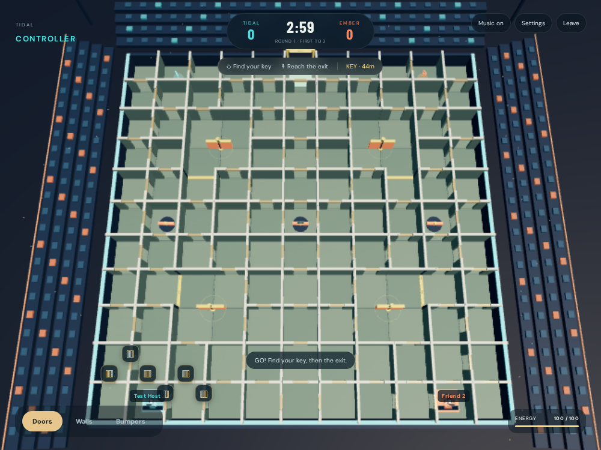

# MAZE RIOT

A full 3D, real-time **2v2 browser game**. One teammate runs the maze; the other operates its walls, gates, and bumpers. Built with Three.js, Socket.IO, and an authoritative Node.js server.



## Play locally

Requires **Node.js 22 or newer**.

```sh
npm ci
npm run dev
```

Frontend changes reload automatically through Vite. After editing `server/` or `shared/game.js`, stop and restart `npm run dev`. The Node process deliberately runs without watch mode so Vite’s generated config files cannot trigger a restart loop.

Open **http://localhost:3000**. Create a room and share its six-character code. Four friends can pick seats in the lobby. The host can fill empty seats with bots, or choose solo practice from the home screen.

For friends on your local network, use your computer's LAN IP instead of localhost. For internet play, deploy the Node server below; a localhost invite cannot be opened on someone else's computer.

## Rules

- **Tidal vs Ember**, one runner and one controller per team.
- Runners collect their own team-coloured key and reach the north exit.
- Each round lasts **90 seconds**. A timeout or simultaneous finish is a draw.
- Teammates **swap roles after every round**. First to **three points** wins.
- Both teams share the same devices. Traps affect either runner.
- Controllers see the opposing runner only within **6.8 metres** of their teammate.
- Use an external voice call to coordinate; voice chat is not built in.

| Role          | Controls                                                                      |
| ------------- | ----------------------------------------------------------------------------- |
| Runner        | WASD / arrow keys to move; mouse to look; Space to jump; E to shove           |
| Runner camera | Click arena to capture mouse; Esc releases; drag-to-look fallback; wheel zoom |
| Controller    | Click labelled devices in the overhead view                                   |

| Device | Energy | Cooldown  | Behaviour                                          |
| ------ | ------ | --------- | -------------------------------------------------- |
| Rotate | 30     | 5 seconds | Turns a junction wall by 90°                       |
| Gate   | 35     | 7 seconds | Closes a doorway for 3 seconds                     |
| Bumper | 40     | 6 seconds | Knocks back nearby grounded runners; jump to dodge |

Energy starts at 100 and regenerates at 9/second. Devices give a 0.75-second warning. Gates and walls refuse unsafe activation through a runner, refunding energy. Shove has a 2.5-second cooldown. Walls cannot be jumped over.

## Production

```sh
npm ci
npm run build
npm start
```

The server serves both the built website and multiplayer connections on **PORT** (default `3000`). Deploy to a host that runs a persistent Node.js process and supports WebSockets. Serve through HTTPS for clipboard and pointer-lock browser features. Graphics, fonts, and audio are self-contained: no API keys or image services are required.

A Dockerfile is included:

```sh
docker build -t maze-riot .
docker run --rm -p 3000:3000 maze-riot
```

Health endpoint: `GET /health`.

**Run one server instance.** Rooms live in memory. Restarting clears matches. Multi-instance hosting needs shared room state and routing before enabling replicas. No database, login, public matchmaking, voice chat, or mobile touch controls are included. The landing page adapts to phone sizes; playing requires a desktop keyboard/mouse and WebGL.

Room codes are unlisted invitations, not account-based access control. Disconnected seats are reserved for 20 seconds and can be recovered on reload via a session token; matches pause during that window. After the grace period, a bot takes the seat. The host migrates to another connected player. Empty rooms are removed.

## Verification

```sh
npm test
npm run build
npx playwright install chromium
npm run test:browser
```

`npm test` covers simulation behaviour and actual Socket.IO room connections: every rotating-wall configuration, key/exit reachability, collision tunnelling, movement normalization, device permissions/energy/cooldowns, activation safety, jumps, scoring/draws, role swaps, match completion, hidden opponent positions, bot navigation, room capacity, seat changes, host migration, reconnection, and malformed requests.

Browser checks use four independent player sessions and cover responsive menus, joining, live roles, controller actions, movement, UI settings, recovery on reload, bot scoring, and role swaps. Screenshots are written to `test-results/`. Set `PLAYWRIGHT_CHROMIUM_EXECUTABLE` to use an existing Chromium binary. GitHub Actions runs build, simulation/network tests, and browser checks.

## Source map

- `shared/game.js` — arena layout, collision, simulation, abilities, navigation, per-player snapshots.
- `server/index.js` — rooms, authoritative ticking, reconnects, permissions, serving.
- `src/scene.js` — procedural stadium, characters, camera, lighting, animation.
- `src/main.js` — menus, HUD, input, prediction, audio, socket client.
- `src/style.css` — interface and responsive layout.

The arena is symmetric, including gates and key routes. Floor tiles and stadium seats use GPU instancing. The runner camera fades occluding walls; the controller gets a wide overhead view. Low graphics disables shadows and reduces pixel density. All art is original procedural geometry.

This is a tested first playable release. Internet latency, device/browser differences, and long-session behaviour still need real-player playtesting; automated checks cannot guarantee zero bugs.
